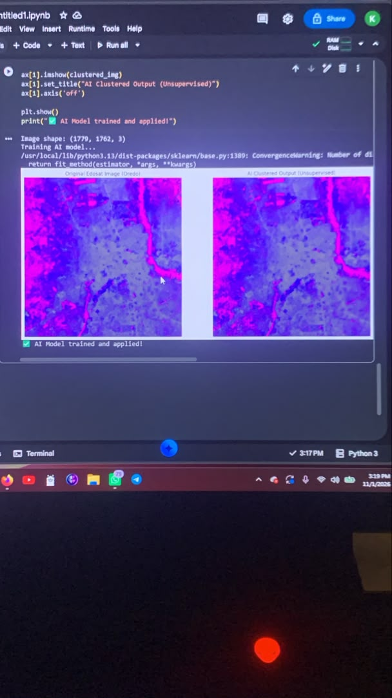
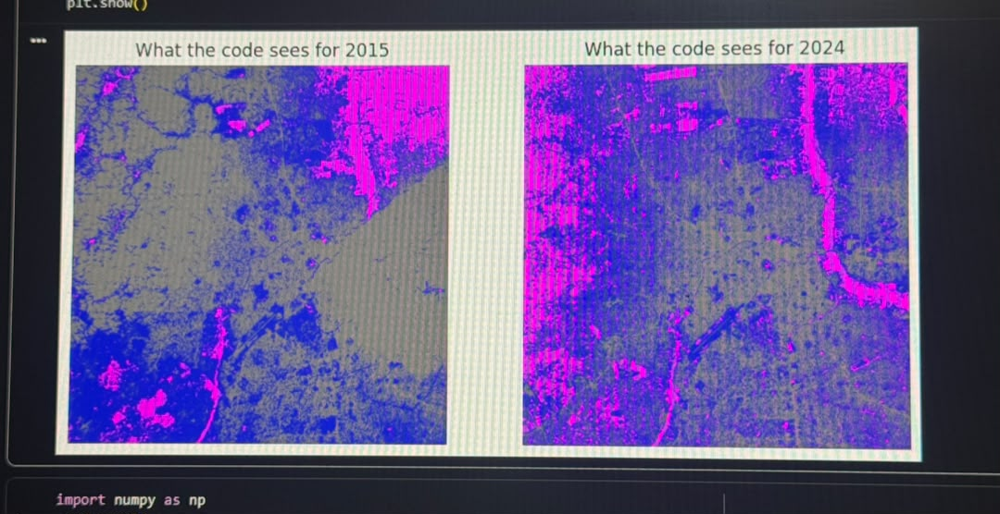
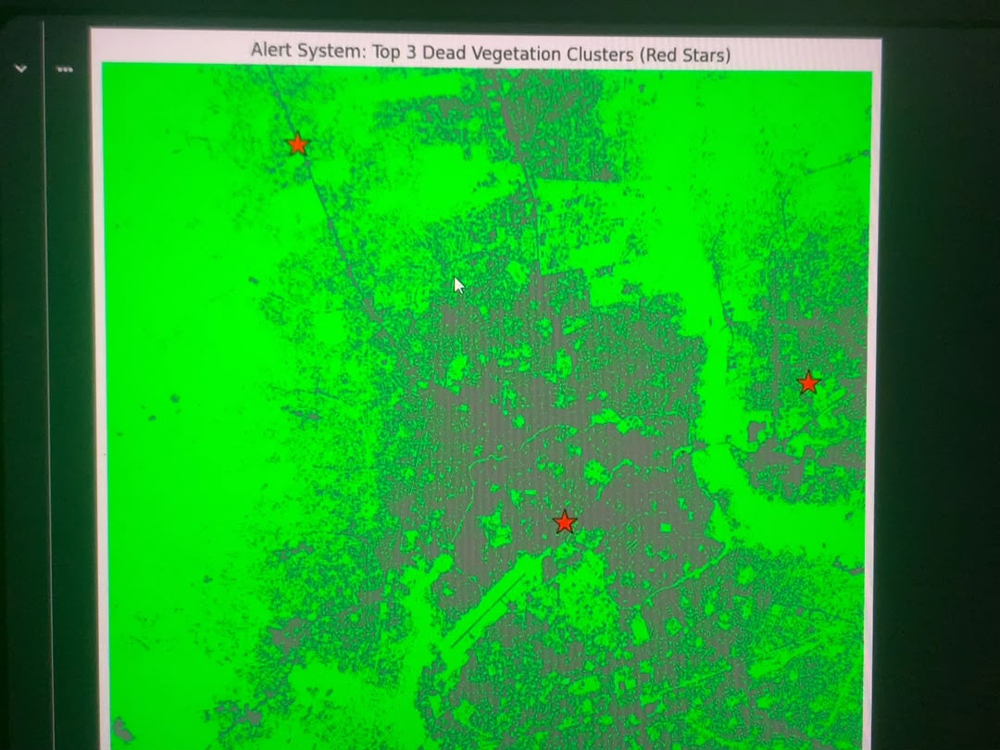
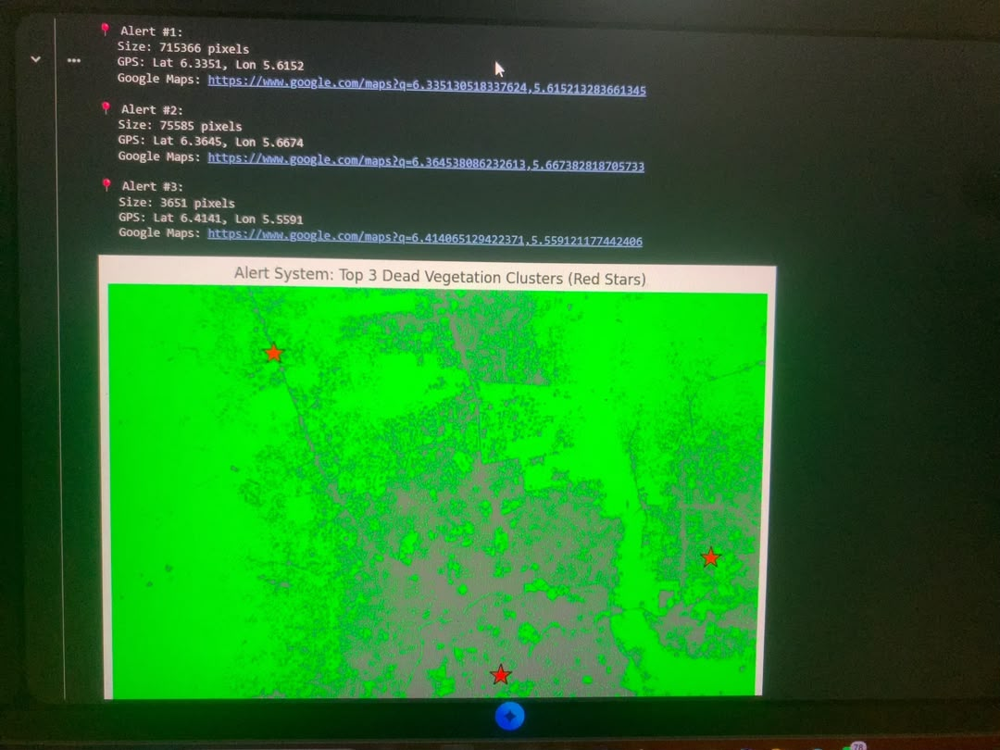

# Edosat

Open satellite dataset for Edo State, Nigeria. Built off-grid from Benin City.

## v0.1 - 18 LGAs
- **Data:** Sentinel-2 L2A (10m resolution)
- **Processing:** NDVI (Normalized Difference Vegetation Index) to highlight vegetation health and urban areas.
- **Coverage:** All 18 LGAs in Edo State.
- **Format:** PNG images (Grey = Urban/Bare, Yellow = Sparse, Green = Healthy Vegetation)

## Why?
No open, LGA-indexed satellite dataset exists for Nigeria. Researchers and NGOs currently have to build this from scratch. Edosat makes it available for AI models, deforestation tracking, and agricultural monitoring.

## Roadmap
- [x] v0.1: Edo State (18 LGAs)
- [ ] v1.0: All 774 Nigerian LGAs
- [ ] v2.0: AI Deforestation Detection Model

## Built by
Kamoru Destiny, Benin City.
## AI Model Preview

*Unsupervised K-Means clustering applied to the Oredo LGA satellite imagery.*
## State-wide AI Maps (v0.2 Preview)
The Random Forest classifier has been run across all 18 LGAs in Edo State. 

*Preview:* 4 AI-classified maps (including Oredo and Esan Central) are uploaded in this repository. The complete dataset of all 18 AI maps can be generated using the provided Python scripts.
## 🚀 Real-World Use Cases

Edosat is designed to solve critical environmental and economic challenges in Nigeria. 

1. **Time-Series Change Detection:** By comparing historical data (e.g., 2015) with current data (2024), our AI can calculate exact forest loss percentages and pinpoint coordinates for government intervention.
2. **Illegal Mining Tracking:** NDVI maps reveal sudden drops in vegetation health. We can build automated alert systems that notify environmental agencies when a forest turns into a mining site.
3. **Agriculture & Crop Health:** Providing farmers and agribusinesses with early warnings on crop stress before it becomes visible to the naked eye, improving food security.
4. **Carbon Credits Verification:** Providing verifiable, open-source proof of forest existence for global companies looking to invest in carbon offset projects in Africa.
## Time-Series Change Detection (2015 vs 2024)

*Side-by-side comparison of Oredo LGA. The shift in color intensity highlights urban expansion and land-use changes over 9 years.*
## Automated Alert System (GPS Coordinates)

*The script automatically detects the largest clusters of dead vegetation/urban expansion and outputs exact GPS coordinates and Google Maps links for environmental monitoring.*
